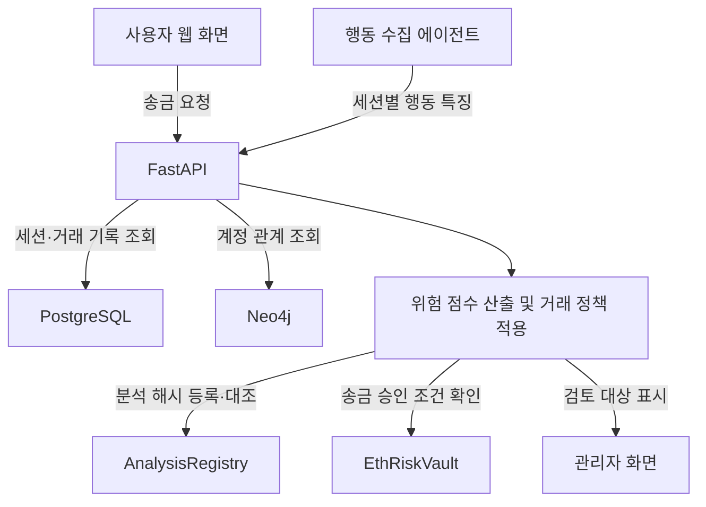

#  AI 기반 이상거래 탐지 및 블록체인 위험 적응형 거래 보안 시스템

[PDF Download](https://github.com/anywheremoon/AIconics/releases/download/v1.0/AIconics_.pdf)

> 2026 종단형 PBL 프로젝트

<!-- 팀원 이름·담당 역할, 개발 기간, 시연 영상 및 보고서 링크를 확정한 뒤 추가합니다. -->

## 프로젝트 소개

합성 신원 사기나 계정 도용이 발생하면 가입 심사와 로그인 인증을 통과한 계정도 이후 위험한 거래를 시도할 수 있습니다. AIconics는 로그인 이후의 키보드·마우스 행동, 접속 환경, 거래 정보, 계정 간 관계를 함께 분석해 송금 전에 위험도를 평가합니다.

평가 결과에 따라 송금을 허용하거나 추가 인증 및 관리자 검토로 연결합니다. 분석 기록의 해시를 블록체인에 등록해, 이후 데이터베이스 기록이 등록 시점과 일치하는지도 검증할 수 있습니다.

## 주요 기능

| 기능 | 동작 |
| --- | --- |
| 행동 기반 지속 인증 | 에이전트가 타이핑 속도, 키 입력 간격, 마우스 이동 거리와 클릭 횟수 등의 특징을 수집하고 로그인 세션에 연결합니다. One-Class SVM으로 평소 행동 패턴에서 벗어나는지를 평가합니다. |
| 신원·거래 위험 분석 | 기기와 접속 환경, 송금 금액 등 신원 및 거래 관련 신호를 평가합니다. |
| 그래프 위험 분석 | Neo4j에서 기기나 접속 환경을 공유하는 계정, 공통 수취인으로 송금하는 계정 등의 관계를 분석합니다. |
| 위험도 기반 거래 제어 | 행동·신원·거래·그래프 점수를 종합하고, 위험도에 따라 송금 허용, 이메일 추가 인증 또는 검토를 적용합니다. |
| 분석 기록 무결성 검증 | `AnalysisRegistry`에 등록한 해시와 현재 분석 기록에서 계산한 해시를 대조해 변경 여부를 확인합니다. |
| ETH 금고 | MetaMask와 연동하고 `EthRiskVault` 스마트 컨트랙트에서 위험 분석에 따른 송금 조건을 적용합니다. |

## 기술 스택

| 영역 | 기술 |
| --- | --- |
| 사용자·관리자 화면 | React, Vite |
| API·행동 수집 | Python, FastAPI, JWT |
| 이상 탐지 | scikit-learn, One-Class SVM |
| 데이터 저장·관계 분석 | PostgreSQL, Neo4j |
| 블록체인 | Solidity, Hardhat, MetaMask |
| 로컬 개발 환경 | Docker, Node.js |

## 시스템 아키텍처

## 위험 등급 및 거래 정책

| 등급 | 위험 점수 | 거래 정책 |
| --- | --- | --- |
| LOW | 0 이상 40 미만 | 송금 허용 |
| MEDIUM | 40 이상 70 미만 | 추가 인증 필요 |
| HIGH | 70 이상 85 미만 | 거래 보류 및 관리자 검토 |
| CRITICAL | 85 이상 | 거래 제한 및 계정 검토 |

그래프 분석을 포함할 때는 행동 24%, 신원 28%, 거래 28%, 그래프 20%를 반영합니다.

## 검증 결과

| 검증 항목 | 확인 결과 |
| --- | --- |
| HIGH 거래 제한 | 송금 제한 응답을 확인했고 거래 전후 송신·수신 계정 잔액이 동일했습니다. |
| 분석 기록 무결성 | 정상 기록의 해시 일치를 확인했습니다. 분석 점수나 거래 정보를 변경했을 때는 불일치가 검출됐습니다. |
| 스마트 컨트랙트 제어 | LOW 송금 성공과 MEDIUM·HIGH·CRITICAL 제한 시나리오를 확인했습니다. 잘못되거나 중복되거나 만료된 서명의 거부도 검증했습니다. |

<!-- 시연 화면을 추가할 때는 사용자 화면의 거래 결과와 관리자 화면의 검토 내역을 나란히 배치합니다. -->

## 시작 가이드

1. Docker에서 PostgreSQL과 Neo4j를 실행합니다.
2. 백엔드의 로컬 환경에 데이터베이스 연결과 JWT 설정을 구성합니다. 이메일 추가 인증을 시연할 때는 Gmail OAuth 설정을 추가합니다.
3. 백엔드 디렉토리에서 `python -m uvicorn main:app --host 0.0.0.0 --port 8000 --reload`를 실행합니다.
4. 프런트엔드에서 백엔드 API 주소를 설정하고 개발 서버를 실행합니다.
5. 사용자로 로그인하고 행동 수집 에이전트를 현재 세션에 연결합니다. 행동 이벤트가 수집된 뒤 위험 분석을 요청합니다.
6. ETH 금고를 시연할 때는 Hardhat 로컬 체인에 컨트랙트를 배포하고, MetaMask와 애플리케이션을 같은 체인에 연결합니다.

<!-- 저장소 적용 시 기준 브랜치의 디렉토리 구조와 환경변수 예제, 의존성 설치 및 컨트랙트 배포 명령을 확인해 이 절에 추가합니다. -->
